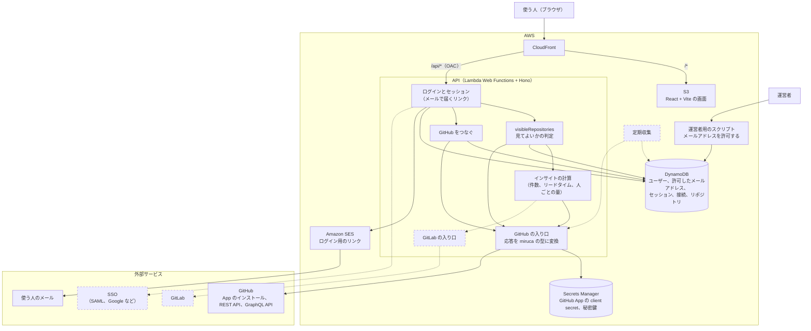
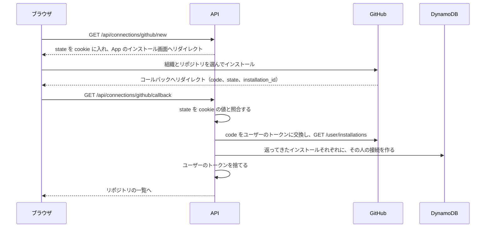
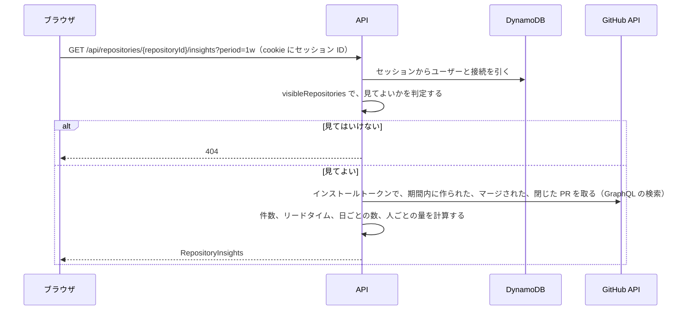

# miruca のアーキテクチャ

0.1 の構成と、将来足すものを1枚にまとめた図です。範囲と要件は [PRD: miruca 0.1](prd/v0.1.md) にあります。点線の部分は 0.1 では作りません。

## 全体の構成

- CloudFront は `/api/*` を API に、それ以外を S3 に送ります。API は CloudFront の署名付きリクエスト（OAC）しか受け付けません。ここまでは今の構成と同じです。
- GitHub とのつなぎ方は Findy Team+ に合わせています。miruca にログインした状態で GitHub App をインストールし、インストールした組織のデータを見ます。
- ログインはメールで届くリンクだけです。使えるメールアドレスは、運営者がスクリプトで許可します。
- 0.1 では、GitHub をつないだ本人だけがその組織のデータを見ます。miruca の組織と招待は 0.1 の次で足します。
- PR のデータは GitHub App のインストールトークンで取ります。だから GitHub のアカウントを持たない人にも同じ数字を出せます。
- GitHub の応答は「GitHub の入り口」で miruca の型に変換します。判定と計算のコードは GitHub の型を知りません。
- 見てよいかの判定は `visibleRepositories` の1か所です。0.1 では、自分の接続のリポジトリだけを見られます。
- 将来は miruca の組織と招待、SSO、GitLab の入り口、定期収集を足します。0.1 では、GitHub と GitLab をまとめる共通のインターフェースは作りません。

## GitHub をつなぐまで

## インサイトを表示するまで

