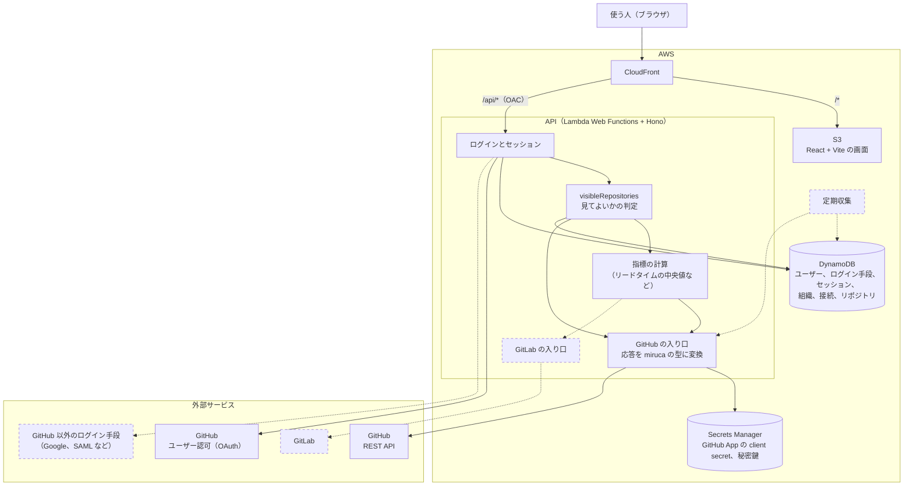
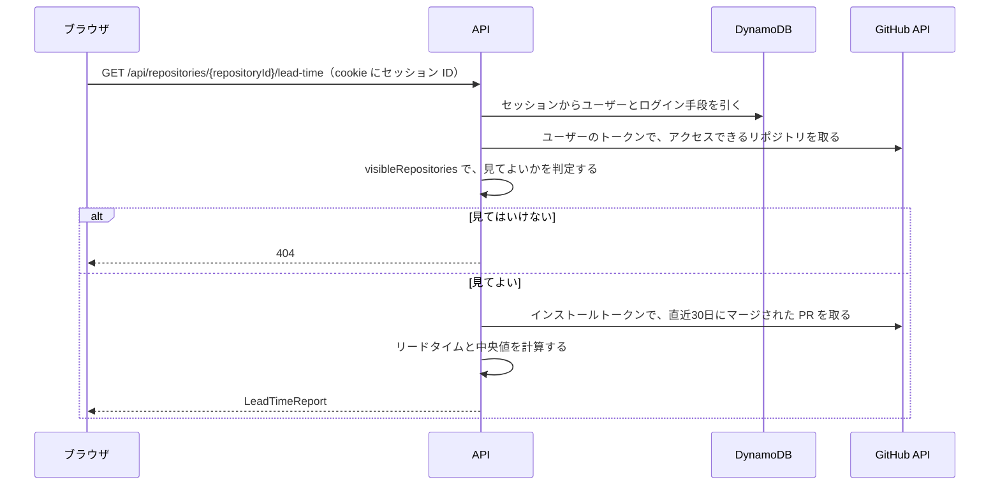

# miruca のアーキテクチャ

0.1 の構成と、将来足すものを1枚にまとめた図です。範囲と要件は [PRD: miruca 0.1](prd/v0.1.md) にあります。点線の部分は 0.1 では作りません。

## 全体の構成

- CloudFront は `/api/*` を API に、それ以外を S3 に送ります。API は CloudFront の署名付きリクエスト（OAC）しか受け付けません。ここまでは今の構成と同じです。
- ユーザー、組織、リポジトリには miruca が ID を発行して、DynamoDB に置きます。GitHub のアカウントはログイン手段の1つ、GitHub App のインストールは組織の接続の1つとして扱います。
- GitHub の応答は「GitHub の入り口」で miruca の型に変換します。判定と計算のコードは GitHub の型を知りません。
- 将来は GitLab の入り口、GitHub 以外のログイン手段、定期収集を足します。0.1 では、GitHub と GitLab をまとめる共通のインターフェースは作りません。

## リードタイムを表示するまで

ユーザーのトークンは「見てよいか」の判定にだけ使います。PR のデータは GitHub App のインストールトークンで取ります。将来、GitHub のアカウントを持たない経営者に全体を見せるときは、`visibleRepositories` の判定だけを変えれば済みます。
